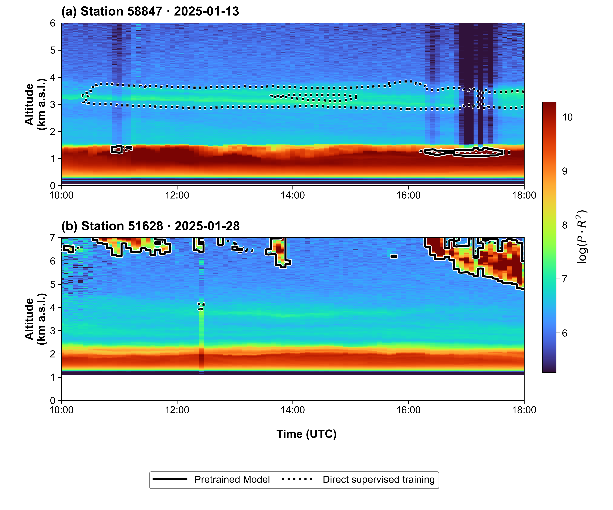
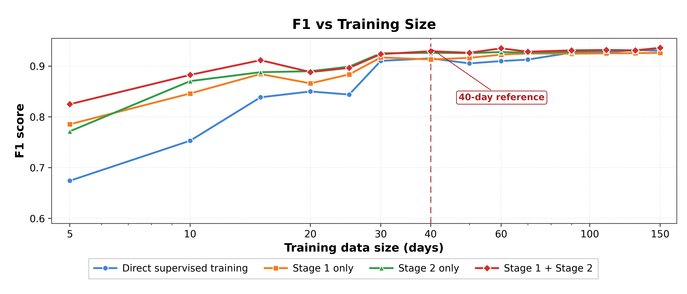

# Cloud-Layer Detection from Ground-Based Lidar

This repository accompanies our work on pixel-wise cloud detection and cloud-boundary retrieval from ground-based multiwavelength polarization lidar observations. The model produces a cloud-probability mask on a time-height grid, from which individual cloud layers, cloud-base heights, and cloud-top heights can be derived.

> **Release status:** the repository is being prepared for public release. Model code, trained weights, configuration files, and a small example dataset will be added after the accompanying manuscript and data documentation are finalized.

## Model overview

The network is a compact **temporal-vertical U-Net** designed around the strong anisotropy of lidar curtains: adjacent profiles provide temporal context, whereas cloud boundaries are primarily organized along the vertical dimension.

### Input and preprocessing

Each sample contains ten consecutive profiles and five lidar channels:

- elastic signals at 1064, 355, and 532 nm;
- volume depolarization ratios at 355 and 532 nm.

The three elastic channels are normalized using station- and channel-specific median and median absolute deviation (MAD) statistics. For elastic channel $c$, let $m_c$ denote the median signal and let $d_c$ denote its MAD. The preprocessing is

$$
z_c=\frac{P_c-m_c}{K d_c+\epsilon},
\qquad
P_c^{norm}=\frac{z_c+1}{2},
\qquad
X_c=\ln\left(1+P_c^{norm}R^2\right).
$$

Here, $d_c$ is the median of $|P_c-m_c|$, $K=4$ in the current configuration, $\epsilon$ is a small constant for numerical stability, and $R$ is range in kilometres. The depolarization-ratio channels are clipped to their physical interval and are not range corrected or logarithmically transformed.

The native vertical grid contains 2,048 bins at 15 m spacing. To reduce computation without sacrificing boundary detail, the grid is retained at full resolution below 12 km, averaged by a factor of four from 12–24 km, and averaged by a factor of eight above 24 km. This produces 1,056 vertical elements for the network.

### Architecture

The current large configuration has approximately **4.52 million parameters** and uses the following components:

- **Temporal-vertical blocks:** a $(3\times1)$ temporal convolution followed by a $(1\times5)$ vertical convolution, with batch normalization, GELU activation, and residual connections when dimensions agree.
- **Vertical-only encoder:** three $(1\times2)$ max-pooling operations reduce height while preserving all ten temporal positions.
- **Multi-scale features:** channel widths increase from 48 to 96, 192, and 384; vertical dilation reaches four in the bottleneck.
- **Gated skip connections:** learned $(1\times5)$ sigmoid gates suppress noisy encoder features before decoder fusion.
- **Dense output head:** a $1\times1$ convolution returns one cloud logit for every time-height pixel.

Unlike a conventional image U-Net, the network never pools along time. It therefore retains the original temporal sampling while learning cloud continuity and vertically sharp cloud boundaries.

## Three-stage training

The training procedure is designed to exploit large volumes of unlabeled lidar data before fine-tuning on a comparatively small manually annotated dataset.

1. **Self-supervised pretraining.** The network reconstructs the complete five-channel input, randomly masked channels, and a randomly masked temporal profile. The objective is

   $$
   \mathcal{L}_{\mathrm{stage\,1}}
   =\mathcal{L}_{\mathrm{recon}}
   +0.5\mathcal{L}_{\mathrm{channel}}
   +0.5\mathcal{L}_{\mathrm{time}}.
   $$

2. **Weakly supervised pretraining.** The reconstruction head is replaced by the segmentation head and the model learns from continuous cloud-score targets. A weighted binary cross-entropy objective accounts for class imbalance and places additional penalties on aerosol-dominated and near-range blind-zone pixels.

3. **Supervised fine-tuning.** The decoder and segmentation head are fine-tuned with manually annotated binary cloud masks using focal binary cross-entropy. The encoder and bottleneck can be frozen to retain the representations learned from the larger pretraining datasets.

## Example cloud masks

Solid contours show the model initialized through the pretraining stages; dotted contours show direct supervised training on the same manually labeled data.

Pretraining is particularly useful when only a small number of manually labeled days is available:

## Output and layer extraction

The sigmoid output is thresholded to obtain a binary cloud mask. Vertically contiguous cloud-positive bins within each profile are treated as individual layers; the lowest and highest positive bins define cloud base and cloud top, respectively. Evaluation utilities for one-to-one physical layer matching and boundary-error statistics will be included in the public release.

## Planned release contents

- PyTorch model and preprocessing code;
- training scripts for all three stages;
- inference and cloud-layer extraction utilities;
- pretrained weights and reproducible configuration files;
- a small, license-compatible example dataset;
- evaluation and figure-generation scripts.

## Citation

The manuscript citation and DOI will be added when available. If you use this repository before then, please cite the repository URL and the release version.

## License

This project is released under the [MIT License](LICENSE).
