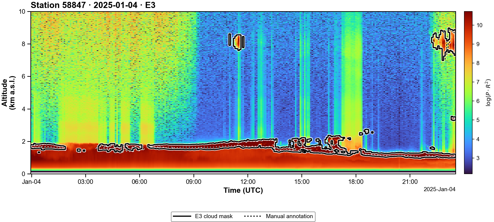

# Cloud-layer detection from ground-based lidar

User release of **A Self-Supervised and Distillation-Guided Framework for Robust Cloud-Layer Identification in Multi-Channel Raman Lidar Networks**. Five lidar channels produce cloud probabilities, masks, cloud bases and **detectable cloud tops**. Default detector: **E3**, threshold **0.65**.

## Install and run

Python 3.10+. Run from this repository; CPU is supported. Add `--device cuda` to use a GPU.

```bash
python -m pip install .
python -m lidar_cloud predict --input data/examples --output outputs/examples
```

Each day produces **one PNG, one layer-height CSV and one prediction H5**, named `<station_id>_<YYYYMMDD>_<model>`. Input files are unchanged. The three labeled examples cover Aksu, Yan'an and Fuzhou; see the [data guide](data/README.md).



Plots show the 1064 nm signal up to **10 km**, with solid model contours and dotted manual labels. Saved predictions retain the full observed height range. [All example figures](results/visualization/README.md).

For 10 profiles, select one H5 with `--profiles 0:10`; omit the option for the whole sequence. Single profiles are supported but not recommended. [Input/output guide](docs/input-format.md) ? [Python example](examples/python_usage.py).

## Verify results

```bash
python -m lidar_cloud verify --data data/examples --output outputs/verification
```

Open `outputs/verification/metrics.png`. The accompanying CSV/JSON files report E1?E5 scores for the **three-day subset**, not the full test.

Place the separate 84-file `TEST_DATASET` beside this repository, then run:

```bash
python scripts/run_test_dataset.py --device cuda --strict
```

Strict mode checks the data and all **420 prediction masks** against the original implementation. Outputs are in `outputs/verification/full_test/`; open `metrics.png` and `reproduction.json`. Omit `--device cuda` for CPU; use `--check-only` for integrity only. [Full-test instructions](docs/test-dataset.md) ? [Archive checksum](results/test_dataset.json).

## Deploy at your station

Prepare the five channels after instrument corrections and temporal averaging, **before MAD, range-squared correction or logarithms**. Estimate and freeze statistics for your own station/instrument:

```bash
python -m lidar_cloud compute-stats --input calibration_h5 --station MY-LIDAR --instrument-id receiver-01 --output outputs/station_stats/my_station.json
python -m lidar_cloud predict --input measurements_h5 --output outputs/my_station --station MY-LIDAR --stats outputs/station_stats/my_station.json
```

Use at least eight representative days, including day and night, with the same processing and averaging as inference. Missing or invalid MAD is an error. Check a locally annotated subset before operational use. [Station deployment guide](docs/station-deployment.md) covers calibration, irregular inputs and the separate Changsha/Beijing reference instruments.

## Pretrained weights for reuse

**R1/R2 are reusable initialization weights; E1?E4 are final detectors, including the staged E3/E4 models.** All six checkpoints contain model parameters only, about 17.33 MiB each. E5 is the reproduced VDE baseline and has no neural weights. Training code, training data and optimizer states are outside this user release.

```python
from lidar_cloud import load_model, load_backbone
pretrained = load_model("R1")    # includes reconstruction head
backbone = load_backbone("R2")  # attach your own task head
```

[Weight sources and checksums](lidar_cloud/resources/models.json) ? [Python usage](examples/README.md) ? [Paper annotation-efficiency figure](results/visualization/annotation_efficiency.png).

## Reference results

E1?E5 follow the manuscript's result order. The pixel values below match Table 2 and the original full-test implementation.

| Model | Configuration | IoU | F1 | Precision | Recall |
|---|---|---:|---:|---:|---:|
| E1 | Direct supervised | 0.865 | 0.928 | 0.909 | 0.947 |
| E2 | Direct supervised | 0.867 | 0.929 | 0.927 | 0.931 |
| **E3** | **Primary staged detector** | **0.881** | **0.937** | **0.925** | **0.949** |
| E4 | Staged comparison detector | 0.877 | 0.935 | 0.924 | 0.945 |
| E5 | Reproduced VDE | 0.540 | 0.702 | 0.639 | 0.778 |

Paper Table 3 boundary values are shown below; E2 is an additional evaluation.

| Model | Cloud-base MAE (m) | Detectable-top MAE (m) | Layer detection |
|---|---:|---:|---:|
| E1 | 55.3 | 94.0 | 94.1% |
| E2 | 63.4 | 98.2 | 94.0% |
| E3 | 59.1 | 82.2 | 93.9% |
| E5 | 123.6 | 250.7 | 86.0% |

The executable boundary rerun differs from archived values by at most 0.023 m because of floating-point matching ties; E1 base/E3 top round to 55.4/82.3 in that rerun. [Measured results](results/README.md) retain the distinction. The release follows verified checkpoint preprocessing (frozen station MAD, K=4); [paper correspondence](docs/paper-correspondence.md) documents the PDF's normalization/provenance discrepancies and VDE teacher/baseline distinction.

## Repository guide

| Location | Purpose |
|---|---|
| `lidar_cloud/` | Inference, calibration, evaluation, visualization and six parameter-only weights |
| `data/` | Three labeled example days and their manifest |
| `docs/` | Input format, station deployment, full-test and paper correspondence guides |
| `examples/` | Python usage and historical instrument-statistics configurations |
| `scripts/` | Strict full-test runner |
| `results/` | Reference scores, figures and one consolidated validation summary |
| `tests/` | Inference/calibration/reproduction checks |
| `outputs/` | Local generated predictions, scores and statistics; excluded from Git |

Cite the manuscript title above and release version 1.0.0; the final DOI is pending. [MIT License](LICENSE) applies to code and released weights. CARLNET observation-data terms are supplied separately by the data owner.
